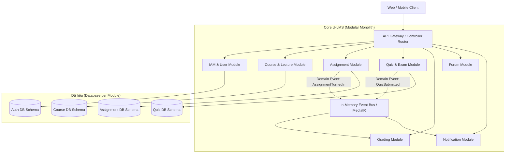
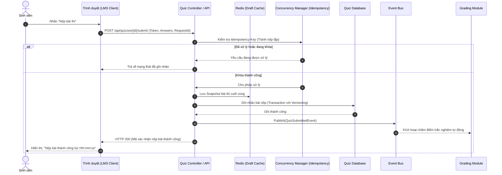

# BÁO CÁO THIẾT KẾ KIẾN TRÚC PHẦN MỀM (MODEL 4+1 VIEWS & TRADE-OFF ANALYSIS)

**Đề tài:** Hệ thống Quản lý Học tập (LMS) cho Trường Đại học  
**Học phần:** Kiến trúc phần mềm  
**Nhiệm vụ:** Bài kiểm tra kỹ năng 2 (KTKN 2)  

---

## 1. Phân tích đánh đổi kiến trúc (Architectural Trade-off Analysis)

### 1.1. So sánh các phong cách kiến trúc ứng viên

| Tiêu chí đánh giá | Phương án 1: Monolithic cổ điển (Layered Monolith) | Phương án 2: Microservices thuần túy (Microservices from Day 1) | Phương án 3 (Đề xuất): Modular Monolith tiến hóa (Evolutionary Modular Monolith) |
| :--- | :--- | :--- | :--- |
| **Độ phức tạp hạ tầng** | Rất thấp (1 repo, 1 database, 1 server) | Rất cao (k8s, service mesh, distributed logging, network latency) | Thấp - Trung bình (1 repo/deployable unit, tách ranh giới module rõ ràng) |
| **Chi phí ban đầu (Khoa - 2.000 SV)** | Rất tiết kiệm | Rất lãng phí tài nguyên và chi phí dev | Tối ưu tuyệt đối cho ngân sách trường đại học |
| **Rủi ro mã nguồn biến thành Spaghetti** | Cực kỳ cao (sau 1-2 năm mở rộng các module chồng chéo phụ thuộc) | Thấp (do tách process và repo) | Thấp (ràng buộc module boundary bằng Clean Architecture & Interface) |
| **Khả năng tiến hóa (Scale lên 30.000 SV)** | Khó khăn, nghẽn cổ chai DB và CPU | Tốt nhất nhưng quá tải ban đầu | **Tối ưu nhất:** Chỉ tách module chịu tải nặng (Quiz/Exam) thành microservice độc lập khi cần |
| **Xử lý giao dịch & Nhất quán dữ liệu** | Đơn giản (ACID Transactions trong 1 DB) | Phức tạp (Saga pattern, eventual consistency) | Đơn giản ở Giai đoạn 1; chuẩn bị Outbox Pattern sẵn sàng cho Giai đoạn 2 |

### 1.2. Quyết định kiến trúc (Architectural Decision Record - ADR)
* **Quyết định:** Chọn **Modular Monolith** kết hợp **Domain-Driven Design (DDD)** và **Clean Architecture** cho Giai đoạn 1 (Khoa).
* **Lý do lựa chọn:** Đáp ứng chính xác bài toán *"Tiến hóa kiến trúc theo quy mô"*. Bắt đầu tinh gọn, chi phí thấp, nhưng ranh giới phân hệ (Course, Assignment, Quiz, Grading, Forum, Notification, Identity) được cách ly tuyệt đối qua Contracts/Interfaces và In-memory Event Bus. Khi mở rộng toàn trường 30.000 SV, phân hệ **Quiz (Kiểm tra)** có thể tách thành dịch vụ phân tán độc lập trong thời gian < 2 tuần mà không làm xáo trộn các module khác.

---

## 2. Mô hình hóa kiến trúc theo 4+1 Views (Kruchten)

### 2.1. Logical View (Khung nhìn logic)
Phân rã hệ thống thành các Bounded Contexts độc lập:
* **Identity & Access Management (IAM):** Xác thực JWT, phân quyền RBAC (Sinh viên, Giảng viên, Admin).
* **Course Module:** Quản lý lớp học phần, bài giảng và tài liệu.
* **Assignment Module:** Quản lý đề bài tập, luồng nộp bài và trạng thái nộp bài.
* **Quiz / Exam Module:** Ngân hàng câu hỏi, phiên làm bài trắc nghiệm thời gian thực, cơ chế chống mất bài.
* **Grading Module:** Chấm điểm trắc nghiệm tự động, giảng viên nhập điểm tự luận, tổng hợp bảng điểm.
* **Forum Module:** Thảo luận, bình luận và hỏi đáp theo khóa học.
* **Notification Module:** Gửi thông báo hệ thống và email.

### 2.2. Process View (Khung nhìn tiến trình & Xử lý đồng thời)
* **Xử lý đồng thời (Concurrency Handling):**
  * Sử dụng cơ chế **Optimistic Locking (Khóa lạc quan qua versioning)** hoặc **Idempotency Key** khi sinh viên nộp bài thi/bài tập nhằm loại bỏ triệt để hiện tượng ghi đè kết quả hoặc nộp trùng lặp (double submission).
  * Bộ đệm **Redis Cache** lưu tạm phiên làm bài trắc nghiệm (Draft State) mỗi khi sinh viên tick chọn đáp án. Khi máy chủ database bận hoặc đứt kết nối, trạng thái làm bài không bị mất.

### 2.3. Development View (Khung nhìn phát triển)
* Cấu trúc thư mục mã nguồn theo chuẩn **Clean Architecture / Ports & Adapters**:
  * `domain/`: Chứa Enterprise Business Rules, Entities, Value Objects, Domain Events (không phụ thuộc bất kỳ thư viện ngoài nào).
  * `application/`: Chứa Use Cases, DTOs, Service Interfaces.
  * `infrastructure/`: Hiện thực Database Repositories, Caching, Event Dispatcher, External Adapters.
  * `api/` (Presentation): REST Controllers, Middlewares, Authentication Guards.

### 2.4. Physical / Deployment View (Khung nhìn triển khai)
* **Giai đoạn 1 (Khoa - 2.000 SV):**
  * 01 Web/Application Server chạy container Docker.
  * 01 Nginx Reverse Proxy (SSL Termination, Rate Limiting).
  * 01 PostgreSQL Database (Schemas tách biệt cho từng module).
  * 01 Redis Instance (Cache & Session store).
* **Giai đoạn 2 (Toàn trường - 30.000 SV):**
  * Load Balancer phân tải vào Cụm Core LMS.
  * Tách module `Quiz/Exam Service` thành cụm Pods/Containers riêng chạy Auto-scaling.
  * Database thiết lập mô hình Read-Write Replica.

### 2.5. +1 Scenarios (Use Case trọng yếu: Nộp bài thi đồng thời)
* Minh họa luồng nộp bài kiểm tra đồng thời (Sequence Diagram xử lý tranh chấp & đảm bảo 0% mất dữ liệu).

